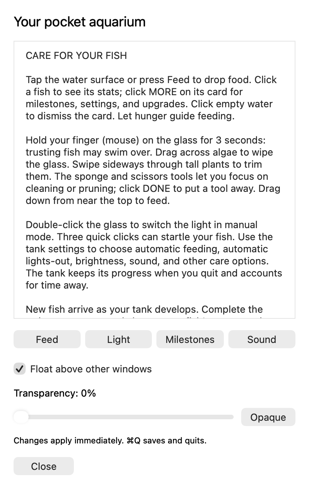
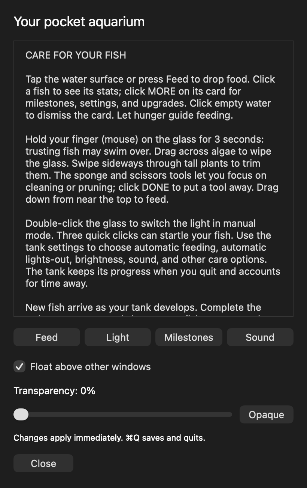

# Pocket Tank for macOS 🐟

A small floating aquarium with a local AI fish brain, adapted from [mediacutlet/pocket-tank](https://github.com/mediacutlet/pocket-tank). The upstream project targets ESP32 hardware; this fork adds a standalone Mac app while preserving its trained model, shared simulation, art, sounds and MIT attribution.

**[Download the macOS alpha](https://github.com/gopichandbusam/pocket-tank-macos/releases/tag/mac-v1.3-alpha)** · [Changes](docs/MAC_CHANGES.md) · [Original device/model documentation](docs/UPSTREAM_README.md)


## Install

1. Download `Pocket Tank.dmg`, open it, and drag **Pocket Tank.app → Applications**.
2. Open the app and complete the original welcome screens to name and color your fish.
3. Click **ⓘ** for care instructions, Feed, Light, Milestones, Sound, floating and transparency controls.

The current downloadable build is **Apple Silicon, macOS 27 or later**, tested on an M5 Pro running macOS 27.0.1. It bundles its local model and SDL runtime; Homebrew and internet access are not needed to run it. The source builds for the host architecture, but Intel and older macOS versions have not been verified.

This is an independent **alpha**, ad-hoc signed rather than Developer ID signed/notarized. macOS may block downloaded copies. Review the source and release checksum; if you trust the download, use the macOS Privacy & Security **Open Anyway** control when available. Do not disable system security globally. This fork is not an official upstream Mac release.

<p> </p>

## Desktop controls and saved state

- Move the aquarium by its title bar; resize it proportionally or use the standard close button.
- Instructions follows system light/dark appearance, scrolls, resizes and closes independently.
- Float above other apps or fade the aquarium down to 20% opacity. Instructions stays readable.
- Use **Command-Q** to save and quit. The aquarium also saves before normal window-close and app-quit requests.
- Fish can rest, inspect plants or follow friends. Constant motion is not a health requirement. Light-off/night affects their decisions.

The tank is saved to `~/Library/Application Support/Pocket Tank/tank.sav`, separate from the app bundle. Replacing the app therefore preserves your aquarium. Window/transparency preferences use the app's macOS preferences domain `com.local.pockettank`.

Saving writes a checked temporary file and atomically replaces the prior snapshot. A failed shutdown save offers **Retry Save / Keep Tank Open**. An interrupted write cannot truncate the previous snapshot; abrupt process death can leave an unused temporary file. Power-loss durability of the directory entry is not guaranteed. Multiple simultaneously launched copies can overwrite the same save; use one instance.

The DMG includes **Uninstall Pocket Tank.app**. It confirms removal, moves recognized app copies to Trash, and optionally removes aquarium data/preferences. Review its displayed paths before confirming. The uninstaller was tested with isolated fixtures; verification does not uninstall your live app.

## Build from source

Requires macOS, Xcode Command Line Tools/Swift, Python 3, Git and SDL2 development files (for example `brew install sdl2`).

```sh
git clone https://github.com/gopichandbusam/pocket-tank-macos.git
cd pocket-tank-macos
bash mac/build.sh
```

The script fetches LVGL **v9.2.2** when absent, builds the host simulator, runs the original engine selftests and the Mac regressions, bundles local runtime dependencies/licenses and creates the app, uninstaller and DMG under `dist/`. Apple Silicon/Intel libraries must match your build architecture. Minimum system versions come from the actual Mach-O binaries; building on a newer SDK does not establish compatibility with older systems.

For a quick simulator build: `make -C sim -j8`. For the audit regressions:

```sh
make -C sim check
python3 mac/tests/test_advisor_mailbox.py
python3 mac/tests/test_persistence.py
python3 mac/verify_source.py
python3 mac/verify_dmg.py
```

The last two checks require locally built bundle/DMG artifacts. CI retains the upstream Linux engine checks and adds host-side Mac regression/build checks. GUI/energy measurements require a real logged-in Mac and are not replaced by CI.

## What changed and what was tested

The upstream baseline is `c57960535d85a3432387b34e4a2c456a7f06be64` (v0.3.3 alpha). Shared `common/`, `model/`, `assets/` and device `firmware/` remain byte-identical to that tracked baseline. The original 14.3M-parameter quantized model and tokenizer are bundled unchanged; inference is local CPU work, with no cloud service or separate GPU model backend.

The audit fixed a simulator mailbox race that overwrote unread fish decisions, a stale roster response that could stall inference after removing a fish, unsafe truncating save writes, silent failed quit saves, and hidden working-directory fallback for damaged bundles. Native AppKit integration adds menus, a themed instruction panel, controls, resizing and input focus handling. Build provenance inside the app records source/resource hashes. See [source parity](docs/audit/source-parity.md), [fish behavior](docs/audit/fish-behavior.md), [adversarial verification](docs/audit/verification.md) and [resource measurements](docs/audit/performance.md).

Known limits include the current OS/architecture/signing scope, inherited firmware-style settings/developer shortcuts, no single-instance coordination, and an inherited save loader that accepts some non-finite numeric values in deliberately corrupted files. No save schema or model training changes were made. Proposed improvements are listed in [MAC_CHANGES.md](docs/MAC_CHANGES.md).

## License and upstream

Pocket Tank is MIT licensed; see [LICENSE](LICENSE). Runtime LVGL and SDL notices ship inside the app. Firmware, training and upstream history are retained for provenance and future rebasing. Device deployment workflows are archived under `docs/upstream-workflows/`; this fork does not publish ESP32 firmware or the upstream website.
